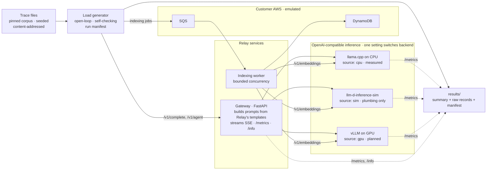

<p align="center">
  
</p>

<p align="center">
  <b>A forward-deployed inference engineering case study, run like a real engagement</b><br>
  Python · FastAPI · llama.cpp · Prometheus · Docker Compose · AWS (emulated)
</p>

<p align="center">
  <a href="#start-here">Start here</a> ·
  <a href="#how-to-review-this-repository">How to review</a> ·
  <a href="#engineering-investigations">Investigations</a> ·
  <a href="#controlled-experiment-rly-4-prefix-caching">Results</a> ·
  <a href="#architecture">Architecture</a> ·
  <a href="#engineering-decisions-and-trade-offs">Decisions</a> ·
  <a href="#reproduce-it">Reproduce</a> ·
  <a href="#methodology-and-evidence">Evidence</a> ·
  <a href="#limitations-and-unresolved-validation">Limitations</a>
</p>

---

## Start here

**What is this?** A practice consulting engagement for an imaginary company, built and measured as if the company were real.

- **The scenario is fictional.** "Relay" is a made-up AI coding assistant with 2M registered users. There are no real users or production traffic. Its problems are planted on purpose, like a training exercise; the job is to find, fix and measure them rigorously.
- **The engineering is real.** This repository contains:
    - working software that stands in front of an AI model and passes requests through to it (a *gateway*);
    - a tool that replays recorded-style traffic at exact times;
    - checks that catch broken or misleading measurements;
    - experiments whose raw data is committed next to the conclusions.
- **The main measured finding.** Every request to Relay's AI model began with a unique tag (an ID and a timestamp). That one line stopped the model server from reusing work it had already done. With the tag moved out of the request text, the server reused **83%** of that work instead of **0.5%**, and the first word of each answer arrived about **4x sooner** (2.5 s → 0.65 s).
    - **Where it was measured:** on an ordinary computer processor (CPU), with a stand-in model.
    - **What it isn't:** a result from production GPUs.
- **Skills this demonstrates:**
    - inference performance engineering (caching, time to first token);
    - backend APIs (FastAPI, streaming responses);
    - experiment design (controls, predictions written down in advance, failed predictions reported);
    - measurement integrity and reproducibility;
    - testing and CI;
    - cloud plumbing (queues and databases, emulated locally; Docker).

**How the request path works, simplified:** an editor sends code to Relay's gateway → the gateway builds the prompt and forwards it to an AI model server → the answer streams back word by word. The banner above shows this path.

**How to read the claims here:**

| Label | Meaning | Present in this repo |
| --- | --- | --- |
| **Measured** (`cpu`) | Observed by running real software on a real inference engine | RLY-4 only, on CPU |
| **Simulated** (`sim`) | Produced by a stand-in server; shows the plumbing works, not how fast inference is | Docker stack smoke test |
| **Projected** (`projection`) | Calculated from a model of the system, never observed | None published yet |
| **Planned** | Designed but not built or run | RLY-0 to RLY-3 and RLY-5 to RLY-7; all GPU work |

---

## How to review this repository

**Non-technical reader (3 minutes):**
- [Start here](#start-here) and the banner's request path above.
- The [main result](#controlled-experiment-rly-4-prefix-caching): read the first table and "How to read these numbers".

**Hiring manager (5–10 minutes):**
- Open the [engineering investigations](#engineering-investigations) table and pick RLY-4, the completed ticket.
- Follow its [walkthrough](tickets/rly-4-prefix-caching/WALKTHROUGH.md), which ends with a 60–90-second summary.
- Then open its [implementation PR](https://github.com/hydrangeas20/relay-inference-case-study/pull/3).

**Engineer (15–30 minutes):**
- **Design:** the [architecture](#architecture) and [decisions](#engineering-decisions-and-trade-offs), with their ADRs.
- **Implementation:** the [PR #3 diff](https://github.com/hydrangeas20/relay-inference-case-study/pull/3/files) and its tests ([`tests/test_rly4.py`](tests/test_rly4.py), [`tests/test_rly4_evidence.py`](tests/test_rly4_evidence.py)).
- **Evidence:** the [methodology and raw evidence](#methodology-and-evidence).
- **Reproduction:** the [reproduction steps](#reproduce-it).
- **Limitations:** the [limitations](#limitations-and-unresolved-validation).

---

## Engineering investigations

Each ticket is a fictional customer complaint. Only RLY-4 has been worked; the rest are planned designs, not solved problems.

| Ticket | Customer complaint | Status | Walkthrough | PR | Evidence |
| --- | --- | --- | --- | --- | --- |
| [RLY-4](tickets/rly-4-prefix-caching/) | "We turned on prefix caching. Nothing changed." | **Measured on CPU** (controlled experiment). Confirmation and GPU runs outstanding | [Walkthrough](tickets/rly-4-prefix-caching/WALKTHROUGH.md) | [#3](https://github.com/hydrangeas20/relay-inference-case-study/pull/3) | [Report](results/rly-4/report.md) · [raw runs](results/rly-4/) · [review](tickets/rly-4-prefix-caching/review/) |
| [RLY-0](tickets/rly-0-observability/) | "We don't even know what's wrong" | Planned | — | — | — |
| [RLY-1](tickets/rly-1-peak-latency/) | "Completions feel sluggish at peak" | Planned | — | — | — |
| [RLY-2](tickets/rly-2-cold-starts/) | "Users hit 30-second waits every morning" | Planned | — | — | — |
| [RLY-3](tickets/rly-3-gpu-cost/) | "Our GPU bill doubled" | Planned | — | — | — |
| [RLY-5](tickets/rly-5-structured-output/) | "Tool calls return broken JSON under load" | Planned | — | — | — |
| [RLY-6](tickets/rly-6-quality-regression/) | "Quality dropped last Tuesday and nobody knows why" | Planned | — | — | — |
| [RLY-7](tickets/rly-7-workload-isolation/) | "Nightly indexing is slowing down daytime users" | Planned | — | — | — |

The infrastructure the tickets run on was built first. These rows aren't customer tickets:

| Foundation | What it delivers | Status | Walkthrough | PR | Evidence |
| --- | --- | --- | --- | --- | --- |
| [Phase 1](docs/phases/phase-1-foundation.md) | Gateway, load generator, indexing worker, corpus, traces, local stack | Merged; tested; Docker stack smoke-tested in CI | [Walkthrough](docs/walkthroughs/phase-1-foundation.md) | [#1](https://github.com/hydrangeas20/relay-inference-case-study/pull/1) | [Tests](tests/) · [local verification](results/phase1-verification/) |
| [Phase 2](docs/phases/phase-2-traffic-model.md) | Traffic model fitted to Azure's public trace | Merged as infrastructure. **Not validated out of sample** | [Walkthrough](docs/walkthroughs/phase-2-traffic-model.md) | [#2](https://github.com/hydrangeas20/relay-inference-case-study/pull/2) | [Validation records](docs/validation/) |

---

## Controlled experiment: RLY-4, prefix caching

> *"We turned on prefix caching. Nothing changed."*

**The bug:** Relay's template starts every prompt with `[relay request_id=… ts=…]`. A prefix cache can only reuse tokens up to the first difference, so every prompt became unique within its first 10 tokens.

**The fix:** request metadata moves out of the prompt and travels as an `X-Request-Id` header ([ADR-0007](docs/decisions/0007-cpu-engine-and-rly4-method.md)).

**Source: `cpu`.** llama.cpp `llama-server` on one CPU thread, running a Qwen2-architecture model with **seeded synthetic weights** and the real Qwen2 tokenizer. The workload is a **controlled editing-session trace**: 8 sessions × 6 inline completions over real source files, with Poisson arrivals at 0.25 requests/s. Each configuration ran 3 times, on a fresh server each run.

| Same 48 requests, same trace | Original template | Fixed template |
| --- | --- | --- |
| Prompt tokens served from the KV cache (server counters) | 0.5% | **82.9%** |
| Median TTFT (median of per-run p50s) | 2,524 ms | **654 ms** (3.9x lower) |
| p95 TTFT (median of per-run p95s) | 5,799 ms | **2,013 ms** (2.9x lower) |
| Per-request TTFT, paired median ratio | — | **0.22** (0.21–0.22 in each repetition) |
| Server-side prefill time per request, paired median ratio (excludes queueing) | — | **0.24** |
| Server busy time during the run | 52.4% | 21.5% |

**How to read these numbers:**
- **CPU only.** These are controlled CPU measurements: not GPU or vLLM latency, not production traffic, and not independently replicated.
- **No quality claim.** The weights are synthetic.
- **Real tokens.** The prompts were built from real source files and counted with the real tokenizer, so the token counts are real.
- **Generated, not hand-entered.** Every figure is generated from committed raw records by [`analyze.py`](tickets/rly-4-prefix-caching/analyze.py). An independent script, [`recompute.py`](tickets/rly-4-prefix-caching/review/recompute.py), reproduces them and shares no code with it.

**Controls:**

| Question | Result | Status |
| --- | --- | --- |
| Did turning the cache on help with the original template? (P4) | No. It was 1.12x *slower* than the cache-off control on the planned runs | **Missed** its predicted 0.9–1.1 band |
| Does removing the header help without a cache? (P5, falsified if ratio < 0.9) | Ratio 0.895 on the planned runs | **Falsified** |
| Is the cache what delivers the gain? | Fixed template, cache on vs off: ratio 0.24 | Supports the mechanism |
| Does the fix help when context doesn't repeat? (negative control) | Ratio 0.90: only the system prompt is reusable | Held |

**Predictions and post hoc runs:**
- **Committed before any full run was read:** six predictions with falsification thresholds ([PREDICTIONS.md](tickets/rly-4-prefix-caching/PREDICTIONS.md)). A disclosed 6-request pilot informed them.
- **Outcome:** P1, P2, P3 and P6 held. P4 and P5 did not.
- **Post hoc control runs:** two cache-off runs were added *after* that result was read. They moved P4 to 1.09 and P5 to 0.92, but they are post hoc and don't change either verdict.
- **Excluded runs:** 4 of the 17 runs failed the load generator's 10 ms send-lag check. They're kept on disk and excluded.

Full write-up: [`tickets/rly-4-prefix-caching/`](tickets/rly-4-prefix-caching/) · Independent review: [`review/`](tickets/rly-4-prefix-caching/review/)

---

## Architecture



| Component | What it does | Where |
| --- | --- | --- |
| Gateway | Relay's `/v1/complete` and `/v1/agent`. Builds prompts, streams Server-Sent Events, measures upstream TTFT | [`src/relay/gateway/`](src/relay/gateway/) |
| Load generator | Replays traces open-loop, records client TTFT, self-checks its schedule and CPU, reconciles timing layers, writes the manifest | [`src/relay/loadgen/`](src/relay/loadgen/), [`src/relay/manifest.py`](src/relay/manifest.py) |
| Indexing worker | Pulls jobs from SQS, embeds chunks, records results in DynamoDB | [`src/relay/worker.py`](src/relay/worker.py) |
| Traces and corpus | Seeded, content-addressed traces built from 8 pinned open-source repositories | [`src/relay/traces/`](src/relay/traces/), [`corpus/`](corpus/) |
| Traffic model | Daily envelope, fitted burstiness, Azure-derived sizes (not validated out of sample) | [`src/relay/traffic/`](src/relay/traffic/), [`traffic/`](traffic/) |
| Local stack | Simulator, Floci (AWS emulator), Prometheus, Grafana, gateway, worker | [`docker-compose.yml`](docker-compose.yml) |

---

## Engineering decisions and trade-offs

| Decision | Why | Trade-off | Record |
| --- | --- | --- | --- |
| The gateway builds Relay's prompts | Prompt construction is part of the system under test; RLY-4's bug lives there | The load generator sends editor context, not ready-made prompts | [ADR-0003](docs/decisions/0003-phase-1-foundation.md) |
| Measure TTFT at every available layer and reconcile them | Each layer fails differently; consistency checks turn silent measurement errors into reported ones | Coarse server histograms limit the check's resolution; llama.cpp exports none | [ADR-0003](docs/decisions/0003-phase-1-foundation.md), [ADR-0006](docs/decisions/0006-reconciliation-check.md) |
| Pre-generated, hash-identified traces | Before/after runs replay byte-identical traffic, and payloads are built before the clock starts | Day-long traces don't yet fit in memory | [ADR-0003](docs/decisions/0003-phase-1-foundation.md) |
| Open-loop load with a self-check | A closed-loop client hides overload; a slow client makes a fast server look slow | Each experiment sets its own send-lag limit (RLY-4: 10 ms); 4 of 17 RLY-4 runs failed it | [methodology](docs/methodology.md) |
| Request metadata outside the prompt | Per-request text at the front of a prompt defeats prefix caching | Consumers must read `X-Request-Id`, not the prompt | [ADR-0007](docs/decisions/0007-cpu-engine-and-rly4-method.md) |
| A real engine on CPU with synthetic weights | The simulator can't model caching; this session had no GPU and no access to downloadable weights | No quality signal; CPU milliseconds don't transfer to a GPU | [ADR-0007](docs/decisions/0007-cpu-engine-and-rly4-method.md) |
| A fitted traffic model, kept unvalidated | Azure's arrivals are bursty in ways Poisson misses | Cycle 1 failed; Cycle 2's Candidate D passed only internally | [ADR-0004](docs/decisions/0004-traffic-model.md), [ADR-0005](docs/decisions/0005-traffic-model-revision.md) |

The ADR-0003 and ADR-0004 rationales are labelled *retrospective*: they were written after the decisions, from the implementation.

---

## Reproduce it

Requires [uv](https://docs.astral.sh/uv/) and Python 3.11+. None of this needs a GPU, an AWS account or an API key.

```bash
git clone https://github.com/hydrangeas20/relay-inference-case-study.git
cd relay-inference-case-study
make setup   # Python deps + the pinned code corpus (8 repos, hash-verified)
make check   # ruff, mypy --strict, pytest
```

**Full Docker stack** (simulator, Floci, gateway, worker, Prometheus, Grafana):

```bash
make up && make run   # replays traces/smoke.jsonl; results land in results/
```

The [Stack smoke workflow](.github/workflows/stack.yml) runs this end to end on a clean GitHub runner. It checks that the replay passes its self-check and that every indexing job reaches the worker.

**RLY-4** (real engine, CPU only, Linux with `taskset`, about an hour on 2 cores):

```bash
git clone https://github.com/ggml-org/llama.cpp ../llama.cpp      # beside this repo, not inside it
git -C ../llama.cpp checkout 2280f0fd163b03d4331d49e08460f66502e35854
cmake -S ../llama.cpp -B ../llama.cpp/build -DLLAMA_CURL=OFF -DLLAMA_OPENSSL=OFF
cmake --build ../llama.cpp/build --target llama-server -j
make rly4-model LLAMA_CPP=../llama.cpp      # synthetic-weight Qwen2 GGUF, sha256 4ecee853…
make rly4-run LLAMA_SERVER=$PWD/../llama.cpp/build/bin/llama-server REPS=3
make rly4-report                            # results/rly-4/report.md
```

**Check the committed evidence without re-running anything:**

```bash
make rly4-traces && git diff --stat traces/   # regenerates both traces; see the note below
python3 tickets/rly-4-prefix-caching/review/recompute.py results/rly-4   # independent recomputation
uv run pytest tests/test_rly4_evidence.py                                 # raw records, report and recompute agree
```

**What regeneration reproduces exactly.** The regenerated traces' request lines, and so their content-addressed `trace_id`s, are identical to the committed ones. The header's `generator_sha256` differs, because it fingerprints the current generator code and [`src/relay/config.py`](src/relay/config.py) gained a setting after the runs (commit [`2918b7c`](https://github.com/hydrangeas20/relay-inference-case-study/commit/2918b7c081a3dd159887ed714526a03dcf596102)). `make rly4-traces` overwrites the committed files, so restore them afterwards with `git checkout -- traces/`.

Without Docker, [`scripts/verify_local_stack.sh`](scripts/verify_local_stack.sh) runs the gateway, the worker and the load generator over real sockets, against llama.cpp and an AWS API emulator. Run it after `make rly4-model`.

---

## Methodology and evidence

- **Every result says where it came from.** Results are tagged `cpu`, `sim`, `gpu`, `projection` or `floci`, and a `sim` or `projection` number is never presented as a measurement ([methodology](docs/methodology.md)).
- **Before/after means the same traffic.** Identical trace files, one factor changed at a time, and a fresh server per run.
- **Runs check themselves.** A run is invalid if send rate falls short, generator CPU saturates, or send lag exceeds the experiment's limit. Invalid runs are kept and listed, never silently dropped.
- **Provenance travels with the data.** Every summary records the git commit and a clean-tree flag, the environment, the gateway's actual template setting, and the inference server's build and model hash.
- **Predictions come first.** Falsification thresholds are committed before full results are read. Post hoc additions are labelled as post hoc.

| Evidence | Location |
| --- | --- |
| Predictions, committed before any full run was read | [`PREDICTIONS.md`](tickets/rly-4-prefix-caching/PREDICTIONS.md) |
| Generated report (all configurations, paired comparisons, invalid runs) | [`results/rly-4/report.md`](results/rly-4/report.md) |
| Raw per-request records, run manifests, server metrics and logs | [`results/rly-4/`](results/rly-4/) |
| Independent review, recomputation and output | [`tickets/rly-4-prefix-caching/review/`](tickets/rly-4-prefix-caching/review/) |
| Evidence-consistency tests | [`tests/test_rly4_evidence.py`](tests/test_rly4_evidence.py) |
| Local end-to-end verification records | [`results/phase1-verification/`](results/phase1-verification/) |
| Traffic-model preregistration, ledger and audits (append-only) | [`docs/validation/`](docs/validation/) |

---

## Limitations and unresolved validation

**RLY-4:**
- **Hardware.** CPU timings on one thread, not GPU or vLLM latency. The cache share may also differ on vLLM, which caches whole fixed-size blocks, evicts under memory pressure and uses the real model's tokenizer.
- **Weights.** They're synthetic, so there's no quality signal.
- **Workload.** One editing session at a time on a one-slot server, so no cache eviction, concurrent users or multi-replica routing. The session shape is assumed, not fitted to Relay data.
- **Sample size.** 48 requests per run and 3 runs per configuration, so p99 supports no conclusion. P4 and P5 did not hold on the planned runs, and the cache-off control's extra runs are post hoc.
- **Still outstanding:**
    - a fresh, preregistered confirmation run on a quiet machine;
    - re-measurement on a GPU with vLLM.

**Traffic model (Phase 2):**
- **Not validated out of sample.** Cycle 1 failed. Cycle 2's Candidate D passed only an internal check on development data.
- **Holdout untouched.** The Wednesday holdout has never been read.
- **Open decisions.** Candidates A and B are not authorised, Amendment 4 is a draft, and the section 8 selection hasn't been made.

**Engagement goals:** the SLOs, the ≥50% cost reduction and the quality target are targets. None has been measured or met.

---

## Repository guide and future work

```
.
├── src/relay/      gateway, worker, load generator, traces, traffic model, manifest
├── tickets/        one folder per ticket: brief, experiment code, write-up
├── results/        run summaries, raw records and manifests (rly-4/ holds RLY-4)
├── traces/         replayable, content-addressed trace files
├── corpus/         pinned repositories and per-file hashes used to build prompts
├── docs/           client brief, methodology, architecture, ADRs, validation records
├── analysis/       Phase 2 traffic-model fitting and validation
├── assets/         README artwork
└── tests/          unit, real-socket and evidence tests (no GPU, no containers)
```

**Next:**
1. **Confirm RLY-4** with a fresh, preregistered run on a quiet machine.
2. **Re-measure RLY-4 on a GPU with vLLM**, using the same traces and the same template switch.
3. **Build a real-GPU baseline**: TTFT against request rate. It's the input to RLY-1, RLY-3 and capacity planning.
4. **Test many users against one cache**: interleaved sessions, eviction, and whether replicas need prefix-aware routing.

The fictional client brief and its SLO targets are in [`docs/case-study.md`](docs/case-study.md).

---

<sub>Built by <a href="https://github.com/hydrangeas20">hydrangeas20</a>. Relay is a fictional customer. Every finding here comes from experiments run in this repository, and the raw records are committed beside the conclusions.</sub>
