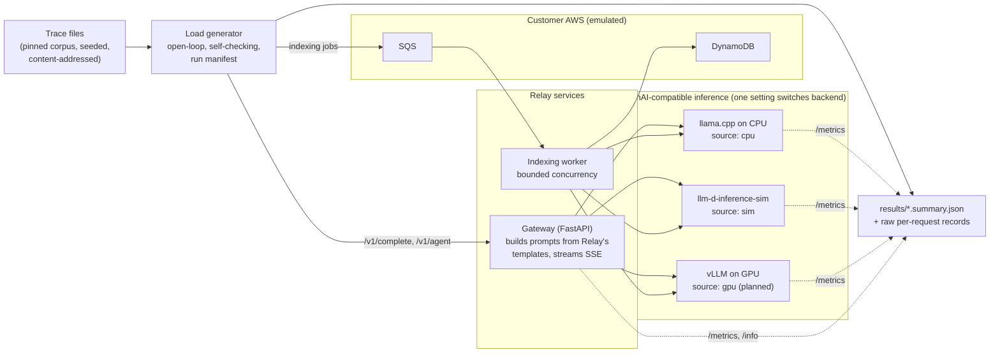

# Relay: an inference engineering case study

A forward-deployed engineering engagement with a fictional customer, run like a real one: reproduce the problem, measure it, fix one thing, measure again, and say exactly what the evidence does and doesn't show.

**Relay** is a fictional AI coding assistant with 2M registered users. It serves a fine-tuned ~7B code model and a small embedding model. It's missing its latency targets while its GPU bill climbs, and a team plan launching in six weeks is expected to double traffic.

---

## First result: RLY-4, "We turned on prefix caching. Nothing changed."

> **Moving one line of per-request metadata out of the prompt let the prefix cache serve 83% of prompt tokens instead of 0.5%. On the same requests, median time to first token fell 3.9x (2.52 s → 0.65 s) and p95 fell 2.9x.**
>
> Measured on a real inference engine (llama.cpp) running on CPU, 3 repetitions, the same replayed trace in every run. Source `cpu`: these are not GPU or vLLM latencies. The share of prompt work saved is what carries over to a GPU; the milliseconds don't.

**The bug:** Relay's template puts `[relay request_id=… ts=…]` at the top of every prompt. A prefix cache reuses tokens only up to the first difference, so the header made every prompt unique from about its 6th token. Relay turned caching on, and nothing changed.

**The fix:** request metadata travels as an `X-Request-Id` header instead of prompt text. Follow-up requests in an editing session then reuse the whole previous prompt.

**The controls:**
- **Cache on vs off:** with the original template, cache on was no faster than cache off.
- **No repeated context:** when context doesn't repeat, the fix gains only about 10%.
- **Predictions first:** predictions and falsification thresholds were committed before results were read, and all six held. One finding was not predicted: with the original template, cache on was about 9% *slower* than cache off, a small overhead this experiment doesn't explain. See [the RLY-4 write-up](tickets/rly-4-prefix-caching/).

---

## What exists today

| Area | State | Evidence |
| --- | --- | --- |
| Gateway, open-loop load generator, indexing worker | Implemented | 277 tests pass (3 skipped). Run end to end over real sockets against llama.cpp and an AWS API emulator (`scripts/verify_local_stack.sh`, results in `results/phase1-verification/`) |
| Run validity and provenance | Implemented | Self-check (rate, send-lag p99, generator CPU), 3-layer TTFT reconciliation, a manifest in every summary |
| RLY-4 prefix caching | **Measured on CPU** (`cpu`) | 15 runs plus 2 extra control runs, raw records committed: [`results/rly-4/`](results/rly-4/) |
| Docker Compose stack (simulator, Floci, Prometheus, Grafana) | Implemented; **smoke-tested end to end in CI** (`sim`) | [Stack smoke workflow](.github/workflows/stack.yml) |
| Traffic model (Phase 2) | Implemented, **not validated out of sample** | [Traffic model status](#traffic-model-status) |
| Real-GPU baseline, quality evals, cost model | **Not started** | No `gpu` result exists yet |
| RLY-0 to RLY-3, RLY-5 to RLY-7 | Planned | Ticket briefs in [`tickets/`](tickets/) |

---

## The engagement

**Goal:** hit Relay's SLOs at launch-scale traffic, cut cost per request by at least 50%, and show no measurable drop in quality. None of these goals has been met or measured yet. They're the engagement's targets, not results.

| Workload           | What it does                               | Model                     | What matters most                |
| ------------------ | ------------------------------------------ | ------------------------- | -------------------------------- |
| Inline completions | Suggests code as the user types            | Fine-tuned ~7B code model | Time to first token              |
| Agent chat         | Answers questions and calls tools via JSON | Same base model           | Valid structured output, latency |
| Repo indexing      | Embeds users' codebases nightly            | Small embedding model     | Throughput and cost              |

### SLOs (targets, not yet measured)

| SLO                                                    | Target                                                 |
| ------------------------------------------------------ | ------------------------------------------------------ |
| Completions p95 time to first token (TTFT), at peak    | < 300 ms                                               |
| Agent chat invalid tool-call rate, at peak concurrency | < 0.5%                                                 |
| Nightly indexing                                       | Done before 06:00 ET, no impact on interactive latency |
| Completion quality                                     | Within 1 point of the FP16 baseline eval               |
| Cost per 1K requests, at launch-scale traffic          | ≥ 50% reduction                                        |

These are initial targets, to be revised against a measured GPU baseline. Full client brief: [`docs/case-study.md`](docs/case-study.md).

### Tickets

| ID                                         | Customer complaint                                  | Theme                           | Status  |
| ------------------------------------------ | --------------------------------------------------- | ------------------------------- | ------- |
| [RLY-0](tickets/rly-0-observability/)      | "We don't even know what's wrong"                   | Observability                   | Planned |
| [RLY-1](tickets/rly-1-peak-latency/)       | "Completions feel sluggish at peak"                 | Batching and concurrency        | Planned |
| [RLY-2](tickets/rly-2-cold-starts/)        | "Users hit 30-second waits every morning"           | Cold starts and autoscaling     | Planned |
| [RLY-3](tickets/rly-3-gpu-cost/)           | "Our GPU bill doubled"                              | Right-sizing and quantization   | Planned |
| [RLY-4](tickets/rly-4-prefix-caching/)     | "We turned on prefix caching. Nothing changed."     | KV cache reuse                  | **Mechanism measured on CPU**; GPU re-measurement pending |
| [RLY-5](tickets/rly-5-structured-output/)  | "Tool calls return broken JSON under load"          | Structured output               | Planned |
| [RLY-6](tickets/rly-6-quality-regression/) | "Quality dropped last Tuesday and nobody knows why" | Evals and safe rollout          | Planned |
| [RLY-7](tickets/rly-7-workload-isolation/) | "Nightly indexing is slowing down daytime users"    | Batch vs. interactive isolation | Planned |

The tickets are deliberately coupled. For example, the quantization win in RLY-3 sets up the regression in RLY-6, and the minimum replicas that fix RLY-2 cost money that RLY-3 is trying to save.

---

## What's real, what's simulated, what's emulated

Every result carries a `source` tag, and every number in this README is labelled with one.

| Source | What runs | Used for | What it can prove |
| --- | --- | --- | --- |
| `gpu` | vLLM on a rented GPU with the real model | Baseline curves, every quality claim | Ground truth at single-GPU scale. **No `gpu` results exist yet** |
| `cpu` | llama.cpp `llama-server` on CPU ([ADR-0007](docs/decisions/0007-cpu-engine-and-rly4-method.md)) | Engine mechanisms that don't need a GPU to exist, such as prefix caching | That a mechanism works on a real engine, and what share of work it saves. Not GPU latency |
| `sim` | [llm-d-inference-sim](https://github.com/llm-d/llm-d-inference-sim) | Plumbing, autoscaling logic, launch-scale traffic | That the system works end to end. Not inference performance: the simulator's latencies are inputs |
| `projection` | Capacity model built from measured per-GPU curves | Launch-scale capacity and cost | A projection, labelled as one |
| `floci` | [Floci](https://github.com/floci-io/floci) AWS emulator (S3, SQS, DynamoDB) | Customer-side plumbing | That the integration works. Nothing about speed |

Two rules follow:

1. **Quality claims only come from a real model.** The simulator models speed, not output. RLY-4's CPU model has synthetic weights, so it can't support any quality claim either.
2. **"2M users" is a traffic model, not a load test.** Nothing here has been load-tested at Relay's scale. Launch-scale numbers will be projections, labelled as such.

Details: [`docs/methodology.md`](docs/methodology.md).

---

## Architecture



- **Measured at three layers.** The load generator measures TTFT at the client, the gateway measures it upstream, and the server reports its own. A run checks that the layers are consistent.
- **Self-checking.** A run is marked invalid if the generator fell behind its schedule.
- **Run manifest.** Every summary records the commit, the environment, the gateway's actual template setting, and the inference server's build and model hash.

Details: [`docs/architecture.md`](docs/architecture.md).

---

## Quickstart

Requires [uv](https://docs.astral.sh/uv/) and Python 3.11+. Nothing below needs a GPU, an AWS account or an API key.

```bash
git clone https://github.com/hydrangeas20/relay-inference-case-study.git
cd relay-inference-case-study
make setup   # Python deps + the pinned code corpus (8 repos, hash-verified)
make check   # ruff, mypy --strict, pytest
```

**Full Docker stack** (simulator, Floci, gateway, worker, Prometheus, Grafana):

```bash
make up && make run   # replays traces/smoke.jsonl; results land in results/
```

**Verified in CI.** The [Stack smoke workflow](.github/workflows/stack.yml) starts the full stack on a clean GitHub runner and replays the smoke trace through it. It first passed on PR #3. Without Docker, `LLAMA_SERVER=… scripts/verify_local_stack.sh` runs the gateway, the worker and the load generator over real sockets, against llama.cpp and an AWS API emulator.

**Reproduce RLY-4** (real engine, CPU only, about 55 minutes). Details are in [the ticket](tickets/rly-4-prefix-caching/).

```bash
git clone https://github.com/ggml-org/llama.cpp && cd llama.cpp && git checkout 2280f0f
cmake -B build -DLLAMA_CURL=OFF -DLLAMA_OPENSSL=OFF && cmake --build build --target llama-server -j
cd -  # back to this repo
make rly4-model LLAMA_CPP=../llama.cpp                       # synthetic-weight Qwen2 GGUF
make rly4-run LLAMA_SERVER=../llama.cpp/build/bin/llama-server REPS=3
make rly4-report                                             # results/rly-4/report.md
```

---

## RLY-4 in detail

**Question:** is the per-request header the reason prefix caching did nothing, and how much time to first token (TTFT) does removing it recover?

**Hypothesis and falsification thresholds:** committed before any full run was read, in [PREDICTIONS.md](tickets/rly-4-prefix-caching/PREDICTIONS.md).

| Design choice | What was done |
| --- | --- |
| Engine | llama.cpp `llama-server` at commit `2280f0f`, 1 slot, 1 thread, pinned to its own core. Restarted for every run, so every run starts with a cold cache |
| Model | Qwen2 architecture with seeded random weights and the real Qwen2 tokenizer ([why](docs/decisions/0007-cpu-engine-and-rly4-method.md)). The model file's hash is in every manifest |
| Workload | 8 editing sessions × 6 inline-completion requests over real source files from the pinned corpus. Prompts are about 1,400–1,800 tokens. The cursor advances 80–240 characters between requests |
| Arrivals | Open-loop Poisson at 0.25 requests/s. The identical trace file is replayed in every run |
| Changed | One factor at a time: the gateway template (`original` / `metadata`) and the server prompt cache (on / off) |
| Negative control | The same arrival times and cursor positions, but no file repeats, so there's no shared context to reuse |
| Validity | Runs failing the load generator's self-check are excluded and listed. Every number below is generated from the committed results by [`analyze.py`](tickets/rly-4-prefix-caching/analyze.py) |

Median across valid runs (min–max). TTFT and E2E are client-measured, in ms, source `cpu`. Cache share comes from the server's own counters.

| Configuration | Valid runs | TTFT p50 | TTFT p95 | TTFT p99 | E2E p50 | Cache share | Server busy | Errors |
| --- | --- | --- | --- | --- | --- | --- | --- | --- |
| Sessions · original template · cache on (Relay today) | 3/3 | 2,524 (2,514–2,671) | 5,799 (5,752–5,964) | 7,473 (7,443–7,657) | 2,873 (2,862–3,001) | 0.5% (0.5%–0.5%) | 52.4% (52.3%–52.7%) | 0 |
| Sessions · fixed template · cache on (the fix) | 3/3 | 654 (622–686) | 2,013 (1,988–2,096) | 2,560 (2,540–2,577) | 991 (932–1,022) | 82.9% (82.9%–82.9%) | 21.5% (21.4%–22.0%) | 0 |
| Sessions · fixed template · cache off (control) | 3/5 | 2,292 (2,281–2,314) | 5,234 (5,217–5,312) | 6,213 (6,198–6,483) | 2,620 (2,609–2,653) | 0.0% (0.0%–0.0%) | 48.9% (48.8%–49.0%) | 0 |
| No shared context · original · cache on (negative control) | 2/3 | 2,388 (2,347–2,429) | 6,611 (6,207–7,015) | 7,793 (7,557–8,028) | 2,726 (2,665–2,787) | 0.5% (0.5%–0.5%) | 49.3% (48.5%–50.1%) | 0 |
| No shared context · fixed · cache on (negative control) | 2/3 | 2,135 (2,101–2,170) | 5,636 (5,533–5,738) | 6,579 (6,318–6,841) | 2,444 (2,388–2,500) | 4.0% (4.0%–4.0%) | 46.5% (45.5%–47.5%) | 0 |

**Paired comparisons** (same requests, median TTFT per request across runs)

| Question | Requests | Median TTFT ratio (p10–p90) | Faster | Follow-ups only: median ratio |
| --- | --- | --- | --- | --- |
| Does the template fix cut TTFT? | 48 | 0.22 (0.09–0.47) | 100% | 0.21 |
| Is the prefix cache what delivers the gain? | 48 | 0.24 (0.10–0.52) | 94% | 0.23 |
| Did turning the cache on do anything with the original template? | 48 | 1.09 (0.99–1.34) | 12% | 1.08 |
| Does the fix help when context doesn't repeat? (negative control) | 48 | 0.90 (0.78–1.02) | 83% | 0.90 |

**Excluded runs.** Four of 17 runs failed the send-lag self-check (p99 12–24 ms against a 10 ms limit). They're kept on disk and listed in [report.md](results/rly-4/report.md). The cache-off control got two extra runs (17 runs in total).

**Mechanism:**
- **Follow-ups:** with the fix, a follow-up request evaluates only the 20–55 newly typed tokens, and its median TTFT ratio is 0.21.
- **First requests:** the first request of a session still prefills the whole file. It gains only from shorter queues (median ratio 0.71).
- **Server load:** server busy time on the same 48 requests fell from 52% to 21.5%.

**Limits:**
- CPU timings, not GPU timings.
- Synthetic weights, so no quality signal.
- One session at a time on a one-slot server, so no eviction or multi-replica routing.
- 48 requests per run, so p99 isn't used for any conclusion.

Full write-up: [`tickets/rly-4-prefix-caching/`](tickets/rly-4-prefix-caching/).

---

## Traffic model status

Phase 2 fitted a traffic model (daily envelope, burstiness, prompt sizes) to Azure's public 2024 code trace and tested it against preregistered criteria. **The burstiness model is not validated out of sample**:

- **Cycle 1 failed.** Both candidates overestimated queue p99 by about 1.3–1.5x.
- **Cycle 2's Candidate D passed internally.** It passed 3 of 4 gating folds, but on development data, under a validator that generally misses biases near 1.15x. That isn't out-of-sample evidence, and it isn't a claim of close fidelity.
- **Wednesday holdout untouched.** The protected Wednesday holdout has never been read.

The full, append-only record is in [`docs/validation/`](docs/validation/). RLY-4 doesn't depend on any of this: it uses Poisson arrivals.

---

## Repository layout

```
.
├── src/relay/            gateway, worker, load generator, traces, traffic model, manifest
├── tickets/              one folder per ticket: brief, experiment code, write-up
├── results/              run summaries and raw records (rly-4/ holds the RLY-4 runs)
├── traces/               replayable, content-addressed trace files
├── corpus/               pinned repos + per-file hashes used to build prompts
├── docs/                 client brief, methodology, architecture, ADRs, validation records
├── analysis/             Phase 2 traffic-model fitting and validation
└── tests/                unit and real-socket tests (no GPU, no containers)
```

---

## Next steps

1. **Re-measure RLY-4 on a GPU with vLLM** (`gpu`): same traces, same template switch, vLLM's prefix-cache metrics. This turns a share of prefill saved into milliseconds on Relay's real setup.
2. **Real-GPU baseline**: TTFT vs request rate, 3 repetitions, Poisson arrivals. It's the input to RLY-1, RLY-3 and capacity planning.
3. **Many users, one cache**: sessions interleaved across many users, cache eviction, and whether replicas need prefix-aware routing to keep hit rates at scale.

---

## About

Built by [hydrangeas20](https://github.com/hydrangeas20). Relay is a fictional customer; every finding reported here comes from experiments run in this repository, and the raw records are committed beside the conclusions.
