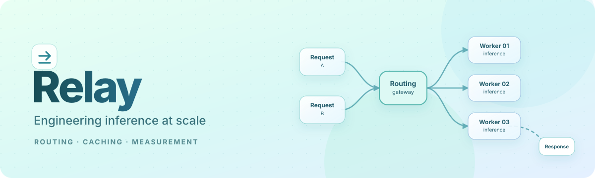
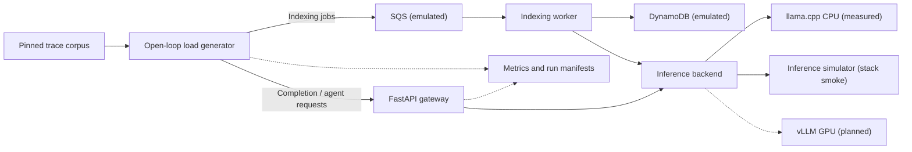

<div align="center">



### Engineering Inference at Scale

**A reproducible inference engineering case study — from a fictional customer problem to real code, tests, and measurements.**

Python · FastAPI · llama.cpp · Prometheus · Docker Compose · AWS (emulated)

[](https://github.com/hydrangeas20/relay-inference-case-study/actions/workflows/ci.yml)
[](https://github.com/hydrangeas20/relay-inference-case-study/actions/workflows/stack.yml)

[Start here](#start-here) · [Investigations](#engineering-investigations) · [Results](#first-measured-result) · [Architecture](#architecture) · [Setup](#quick-start) · [Reproduce](#reproduce-the-prefix-caching-experiment) · [Evidence](#evidence-and-methodology) · [Limitations](#limitations-and-next-steps)

</div>

---

## Start here

**Relay is a fictional AI coding-assistant company with a real engineering investigation behind it.** The customer scenario imagines 2 million registered users, slow responses, and rising GPU costs. **Those users and production traffic are fictional.** The gateway, load generator, indexing worker, tests, and controlled CPU inference experiments in this repository are implemented software.

The first investigation asks a simple question: **Why didn't enabling prefix caching make responses faster?** The answer was a changing request identifier placed at the beginning of every prompt. Moving that identifier into request metadata allowed the inference engine to reuse previous work.

**For readers:** [See how RLY-4 was investigated](tickets/rly-4-prefix-caching/) · [Inspect implementation PR #3](https://github.com/hydrangeas20/relay-inference-case-study/pull/3) · [Read the experimental evidence](results/rly-4/)

## First measured result

**RLY-4: “We turned on prefix caching. Nothing changed.”**

| Controlled CPU experiment  | Original template | Fixed template |
| -------------------------- | ----------------: | -------------: |
| Median time to first token |        **2.52 s** |     **0.65 s** |
| p95 time to first token    |            5.80 s |         2.01 s |
| Prefix-cache reuse         |              0.5% |      **82.9%** |
| Server busy time           |             52.4% |          21.5% |

**3.9× lower median time to first token** in the controlled CPU experiment. The same 48-request editing-session trace was replayed across three valid repetitions per main configuration. These measurements use **llama.cpp on CPU with seeded synthetic model weights**. They are **not** production, GPU, vLLM, quality, or cost-savings results. A fresh quiet-machine confirmation and GPU validation remain outstanding.

**What changed:** Request-specific ID/timestamp metadata moved from the beginning of the model prompt into the `X-Request-Id` HTTP header. Repeated context could then be reused by the prefix cache.

\***\*Investigation approach:** Each engineering investigation follows a consistent process: **problem → hypothesis → code change → tests → measurements → limitations**. The [RLY-4 investigation](tickets/rly-4-prefix-caching/) provides a complete example of this methodology.

[Full RLY-4 investigation](tickets/rly-4-prefix-caching/) · [Predictions](tickets/rly-4-prefix-caching/PREDICTIONS.md) · [Raw results](results/rly-4/) · [Independent recomputation](tickets/rly-4-prefix-caching/review/recompute.py)

---

## How to review this repository

| Your role                                    | Suggested path                                                                                                                                                                                                    |
| -------------------------------------------- | ----------------------------------------------------------------------------------------------------------------------------------------------------------------------------------------------------------------- |
| **Project overview· 3 minutes**              | Read [Start here](#start-here), [First measured result](#first-measured-result), and the diagram below.                                                                                                           |
| **Engineering Investigations· 5–10 minutes** | Choose an item in [Engineering investigations](#engineering-investigations), follow its ticket write-up, then open the implementation PR and evidence.                                                            |
| **Technical Deep Dive· 15–30 minutes**       | Inspect [architecture](docs/architecture.md), [PR #3](https://github.com/hydrangeas20/relay-inference-case-study/pull/3), [tests](tests/), [methodology](docs/methodology.md), and [raw records](results/rly-4/). |

## Engineering investigations

**Only RLY-4 has a measured inference optimization.** Other customer tickets are planned; the foundational infrastructure and traffic model are separate engineering workstreams.

| Ticket                                     | Customer problem                                     | Status                                        | How to inspect                                                                                                                                                    |
| ------------------------------------------ | ---------------------------------------------------- | --------------------------------------------- | ----------------------------------------------------------------------------------------------------------------------------------------------------------------- |
| **[RLY-4](tickets/rly-4-prefix-caching/)** | “We turned on prefix caching. Nothing changed.”      | **Measured on CPU**; confirmation/GPU pending | [Walkthrough and report](tickets/rly-4-prefix-caching/) · [PR #3](https://github.com/hydrangeas20/relay-inference-case-study/pull/3) · [Evidence](results/rly-4/) |
| [RLY-0](tickets/rly-0-observability/)      | “We don't even know what's wrong.”                   | Planned                                       | Ticket brief                                                                                                                                                      |
| [RLY-1](tickets/rly-1-peak-latency/)       | “Completions feel sluggish at peak.”                 | Planned                                       | Ticket brief                                                                                                                                                      |
| [RLY-2](tickets/rly-2-cold-starts/)        | “Users hit 30-second waits every morning.”           | Planned                                       | Ticket brief                                                                                                                                                      |
| [RLY-3](tickets/rly-3-gpu-cost/)           | “Our GPU bill doubled.”                              | Planned                                       | Ticket brief                                                                                                                                                      |
| [RLY-5](tickets/rly-5-structured-output/)  | “Tool calls return broken JSON under load.”          | Planned                                       | Ticket brief                                                                                                                                                      |
| [RLY-6](tickets/rly-6-quality-regression/) | “Quality dropped last Tuesday and nobody knows why.” | Planned                                       | Ticket brief                                                                                                                                                      |
| [RLY-7](tickets/rly-7-workload-isolation/) | “Nightly indexing is slowing down daytime users.”    | Planned                                       | Ticket brief                                                                                                                                                      |

### Foundation and traffic-model engineering

- **[PR #1 — Foundation](https://github.com/hydrangeas20/relay-inference-case-study/pull/1):** gateway, load generator, worker, reproducible corpus, tests, and initial stack.
- **[PR #2 — Traffic model](https://github.com/hydrangeas20/relay-inference-case-study/pull/2):** development-data fitting and validation attempts. **Not validated out of sample.** The protected Wednesday holdout remains untouched, and several model-selection decisions remain unresolved.
- **[PR #3 — Prefix-caching experiment](https://github.com/hydrangeas20/relay-inference-case-study/pull/3):** implemented change, controlled runs, tests, review, and committed evidence.

For an interview, follow **problem → hypothesis → code change → tests → measurements → limitations**. The [RLY-4 ticket](tickets/rly-4-prefix-caching/) is the primary starting point.

---

## Architecture



The load generator replays pinned traces, measures client latency, and rejects runs that fail configured validity checks. The gateway constructs prompts and streams responses; the worker handles indexing traffic. Prometheus and Grafana support the Docker stack. See [architecture details](docs/architecture.md).

## Quick start

**Requirements:** Python 3.11+, [`uv`](https://docs.astral.sh/uv/), Git. The checks below do not require an API key, AWS account, or GPU.

```bash
git clone https://github.com/hydrangeas20/relay-inference-case-study.git
cd relay-inference-case-study
make setup
make check
```

`make setup` installs dependencies and retrieves the pinned, hash-verified code corpus. `make check` runs the repository's linting, type checks, and tests.

### Run the simulated Docker stack

**Additional requirement:** Docker with Compose.

```bash
make up
make run
```

The stack includes the inference simulator, AWS emulator (Floci), gateway, worker, Prometheus, and Grafana. This checks integration and plumbing; **simulator timing is not measured inference latency**.

### CI and reproducibility

- [**CI**](.github/workflows/ci.yml) — runs on pushes to `main` and pull requests: Ruff lint/format, strict mypy, pytest excluding integration tests, and Docker Compose configuration validation.
- [**Stack smoke**](.github/workflows/stack.yml) — runs on pull requests or manual dispatch: boots the Docker stack and replays completion, agent, and indexing requests end to end.
- [**Run manifests and provenance**](docs/methodology.md) — preserve environment, model/build hashes, source tags, configuration, and validity outcomes.

## Reproduce the prefix-caching experiment

**CPU-only; Linux with `taskset`; approximately one hour on two cores.** Run `make setup` first. This uses a pinned llama.cpp version and a synthetic-weight Qwen2-architecture model with a real tokenizer.

```bash
git clone https://github.com/ggml-org/llama.cpp ../llama.cpp
git -C ../llama.cpp checkout 2280f0fd163b03d4331d49e08460f66502e35854
cmake -S ../llama.cpp -B ../llama.cpp/build -DLLAMA_CURL=OFF -DLLAMA_OPENSSL=OFF
cmake --build ../llama.cpp/build --target llama-server -j

make rly4-model LLAMA_CPP=../llama.cpp
make rly4-run LLAMA_SERVER=$PWD/../llama.cpp/build/bin/llama-server REPS=3
make rly4-report
```

The experiment's design, controls, run exclusions, and interpretation are documented in [RLY-4](tickets/rly-4-prefix-caching/). Results are written to `results/rly-4/`.

## Evidence and methodology

| Evidence type                           | Where to find it                                                           |
| --------------------------------------- | -------------------------------------------------------------------------- |
| Hypotheses and preregistered thresholds | [PREDICTIONS.md](tickets/rly-4-prefix-caching/PREDICTIONS.md)              |
| Raw CPU experiment records              | [results/rly-4/](results/rly-4/)                                           |
| Generated report                        | [results/rly-4/report.md](results/rly-4/report.md)                         |
| Independent recomputation               | [review/recompute.py](tickets/rly-4-prefix-caching/review/recompute.py)    |
| Implementation and code review          | [PR #3](https://github.com/hydrangeas20/relay-inference-case-study/pull/3) |
| Experiment design decision              | [ADR-0007](docs/decisions/0007-cpu-engine-and-rly4-method.md)              |
| General measurement methodology         | [docs/methodology.md](docs/methodology.md)                                 |
| Traffic-model validation history        | [docs/validation/](docs/validation/)                                       |

**Source labels matter:** `cpu` means real llama.cpp CPU execution; `sim` means simulated inference; `gpu` is planned, not measured; `projection` means model-derived estimates, not observations; `floci` means emulated AWS integration.

## Limitations and next steps

- The fictional 2M-user scenario is **not** evidence of real users, production deployment, or production-scale load testing.
- RLY-4 used a **CPU engine and synthetic weights**, so it cannot support GPU latency or model-quality claims.
- The experiment used one inference slot and a controlled editing-session workload; cache eviction and multi-replica routing remain untested.
- Four of 17 experimental runs failed the configured send-lag validity gate and remain preserved in the evidence. The original failed/missed predictions and post hoc controls are disclosed.
- The Phase 2 traffic model is **not validated out of sample**; its Wednesday holdout remains protected.
- Real-GPU baseline, quality evaluation, cost model, and the other customer tickets are not complete.
- The customer targets — including p95 TTFT below 300 ms and at least 50% lower cost per 1,000 requests — are **targets, not achieved results**.

Next: independent quiet-machine confirmation, GPU remeasurement, quality evaluation, and further tickets. See [the case-study brief](docs/case-study.md) for the full scope.

---

## Repository guide

| Folder                     | Purpose                                                |
| -------------------------- | ------------------------------------------------------ |
| [`src/relay/`](src/relay/) | Gateway, load generator, worker, traces, traffic model |
| [`tickets/`](tickets/)     | Engineering investigations and ticket briefs           |
| [`results/`](results/)     | Measured records and reports                           |
| [`traces/`](traces/)       | Replayable workload traces                             |
| [`corpus/`](corpus/)       | Pinned source-code corpus and hashes                   |
| [`docs/`](docs/)           | Architecture, methodology, decisions, validation       |
| [`analysis/`](analysis/)   | Traffic-model analysis                                 |
| [`tests/`](tests/)         | Automated verification                                 |

**Relay's central principle:** make one engineering change, measure it against controlled evidence, and state precisely what the result does — and does not — establish.
