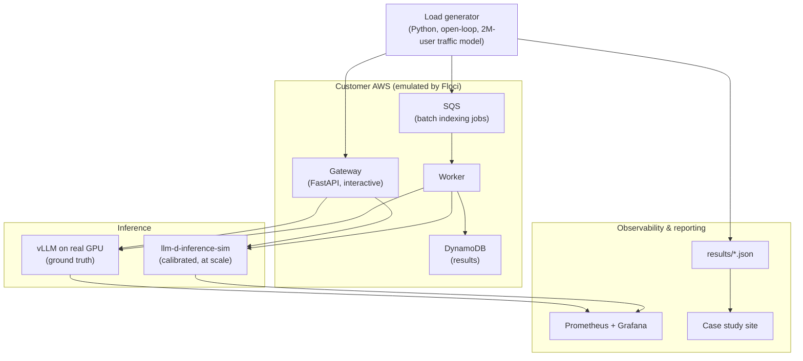

# Relay: An Inference Engineering Case Study

A forward-deployed engineering engagement, run end to end on a fictional customer.

**Relay** is a fictional AI coding assistant with 2M registered users. It serves a fine-tuned code model and an embedding model, and it's missing its latency targets while its GPU bill climbs. It launches a team plan in six weeks that's expected to double traffic.

This repo is the engagement: eight tickets in the customer's own words. For each one there's a reproduction of the problem, a diagnosis, a fix, and before/after measurements. It ends with a capacity plan and a report to Relay's CTO.

> **Status:** 🚧 In progress. Every ticket below is _planned_. Results appear here only once they've been measured, and none of the numbers on this page are placeholders dressed up as findings.

---

## The engagement

**Goal:** hit Relay's SLOs at launch-scale traffic, cut cost per request by at least 50%, and show no measurable drop in quality.

| Workload           | What it does                               | Model                     | What matters most                |
| ------------------ | ------------------------------------------ | ------------------------- | -------------------------------- |
| Inline completions | Suggests code as the user types            | Fine-tuned ~7B code model | Time to first token              |
| Agent chat         | Answers questions and calls tools via JSON | Same base model           | Valid structured output, latency |
| Repo indexing      | Embeds users' codebases nightly            | Small embedding model     | Throughput and cost              |

### SLOs

These are initial targets, to be revised against the measured baseline. That revision is part of the engagement and is recorded in [`docs/decisions/`](docs/decisions/).

| SLO                                                    | Target                                                 |
| ------------------------------------------------------ | ------------------------------------------------------ |
| Completions p95 time to first token (TTFT), at peak    | < 300 ms                                               |
| Agent chat invalid tool-call rate, at peak concurrency | < 0.5%                                                 |
| Nightly indexing                                       | Done before 06:00 ET, no impact on interactive latency |
| Completion quality                                     | Within 1 point of the FP16 baseline eval               |
| Cost per 1K requests, at launch-scale traffic          | ≥ 50% reduction                                        |

Full client brief: [`docs/case-study.md`](docs/case-study.md)

---

## Tickets

| ID                                         | Customer complaint                                  | Theme                           | Status  |
| ------------------------------------------ | --------------------------------------------------- | ------------------------------- | ------- |
| [RLY-0](tickets/rly-0-observability/)      | "We don't even know what's wrong"                   | Observability                   | Planned |
| [RLY-1](tickets/rly-1-peak-latency/)       | "Completions feel sluggish at peak"                 | Batching and concurrency        | Planned |
| [RLY-2](tickets/rly-2-cold-starts/)        | "Users hit 30-second waits every morning"           | Cold starts and autoscaling     | Planned |
| [RLY-3](tickets/rly-3-gpu-cost/)           | "Our GPU bill doubled"                              | Right-sizing and quantization   | Planned |
| [RLY-4](tickets/rly-4-prefix-caching/)     | "We turned on prefix caching. Nothing changed."     | KV cache reuse                  | Planned |
| [RLY-5](tickets/rly-5-structured-output/)  | "Tool calls return broken JSON under load"          | Structured output               | Planned |
| [RLY-6](tickets/rly-6-quality-regression/) | "Quality dropped last Tuesday and nobody knows why" | Evals and safe rollout          | Planned |
| [RLY-7](tickets/rly-7-workload-isolation/) | "Nightly indexing is slowing down daytime users"    | Batch vs. interactive isolation | Planned |

**Order of work:** RLY-0 (see the problem), then RLY-4 and RLY-1 (quick wins), RLY-3 and RLY-2 (cost vs. latency), RLY-5 and RLY-6 (correctness), and RLY-7 (isolation). The tickets are deliberately coupled. For example, the quantization win in RLY-3 sets up the regression in RLY-6, and the minimum replicas that fix RLY-2 cost money that RLY-3 is trying to save.

---

## What's real and what's simulated

Inference performance claims only mean something if you know where they came from. This project uses three layers, and every result is tagged with the one it came from.

| Layer                                                                                                                                       | Used for                                                                             | Proves                                                 |
| ------------------------------------------------------------------------------------------------------------------------------------------- | ------------------------------------------------------------------------------------ | ------------------------------------------------------ |
| **Real GPU** (vLLM on a rented single GPU)                                                                                                  | Baseline performance curves, all quality evals, every fix involving the model itself | Ground truth at small scale                            |
| **Calibrated simulator** ([llm-d-inference-sim](https://github.com/llm-d/llm-d-inference-sim), [Vidur](https://github.com/microsoft/vidur)) | Launch-scale traffic, autoscaling, cold starts, capacity planning                    | Behaviour at scale, _projected from_ real measurements |
| **Emulated customer AWS** ([Floci](https://github.com/floci-io/floci))                                                                      | S3, SQS and DynamoDB plumbing on the customer side                                   | The integration works, not how fast inference is       |

Two rules follow:

1. **The simulator only models speed.** It can't tell whether a quantized model got worse, so every quality claim comes from a real model on a real GPU.
2. **"2M users" is a traffic model, not a load test.** Launch-scale numbers are projections from a simulator calibrated against real single-GPU runs, and they're labelled that way wherever they appear.

Details: [`docs/methodology.md`](docs/methodology.md)

---

## Architecture



The gateway and worker talk to an OpenAI-compatible endpoint. Pointing them at the real GPU or at the simulator is a single config change, so the whole system can be developed and debugged at no cost before any GPU time is rented.

Details: [`docs/architecture.md`](docs/architecture.md)

---

## Quickstart

Requires Docker, [uv](https://docs.astral.sh/uv/), and Python 3.11+.

```bash
git clone https://github.com/hydrangeas20/relay-inference-case-study.git
cd relay-inference-case-study

make setup   # install Python deps into .venv
make up      # start Floci, the inference simulator, Prometheus, Grafana
make check   # lint + tests
```

| Service                                 | URL                                             |
| --------------------------------------- | ----------------------------------------------- |
| Floci (AWS endpoint)                    | http://localhost:4566                           |
| Inference simulator (OpenAI-compatible) | http://localhost:8000/v1                        |
| Prometheus                              | http://localhost:9090                           |
| Grafana                                 | http://localhost:3000 (anonymous viewer access) |

`make down` stops everything. Nothing in the quickstart needs an AWS account, an API key, or a GPU.

---

## Repository layout

```
.
├── docs/
│   ├── case-study.md        # Client brief: Relay, workloads, SLOs
│   ├── methodology.md       # Measurement rules, results schema, what counts as valid
│   ├── architecture.md      # System design and service responsibilities
│   └── decisions/           # Architecture decision records (ADRs)
├── tickets/                 # One folder per ticket: brief, code, results, write-up
├── src/relay/               # Shared Python package (gateway, worker, load generator, evals)
├── infra/                   # Prometheus and Grafana config
├── results/                 # Machine-readable results of every run (source of all charts)
├── site/                    # Published case study site (generated from results/)
├── tests/
└── docker-compose.yml
```

---

## Roadmap

- [ ] **Phase 1: Foundation.** Local stack, gateway, worker, load generator, one request end to end against the simulator
- [ ] **Phase 2: Traffic model and results schema.** Relay's 2M-user traffic shape and the JSON format every run writes
- [ ] **Phase 3: Real GPU baseline.** vLLM benchmarks and quality evals on a rented GPU, then simulator calibration
- [ ] **Phase 4: Tickets.** Reproduce, fix and measure RLY-0 through RLY-7
- [ ] **Phase 5: Report.** Case study site, capacity plan, report to Relay's CTO, and a write-up on Applied Alignment

---

## About

Built by **Hamda Aden** (https://github.com/hydrangeas20). Relay is a fictional customer scenario designed for hands-on inference engineering practice; all reported findings will come from experiments conducted in this repository.
